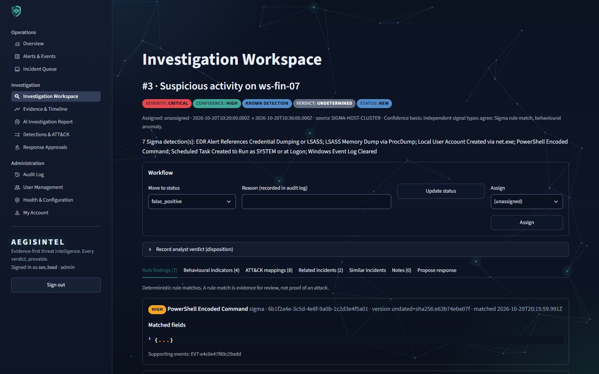
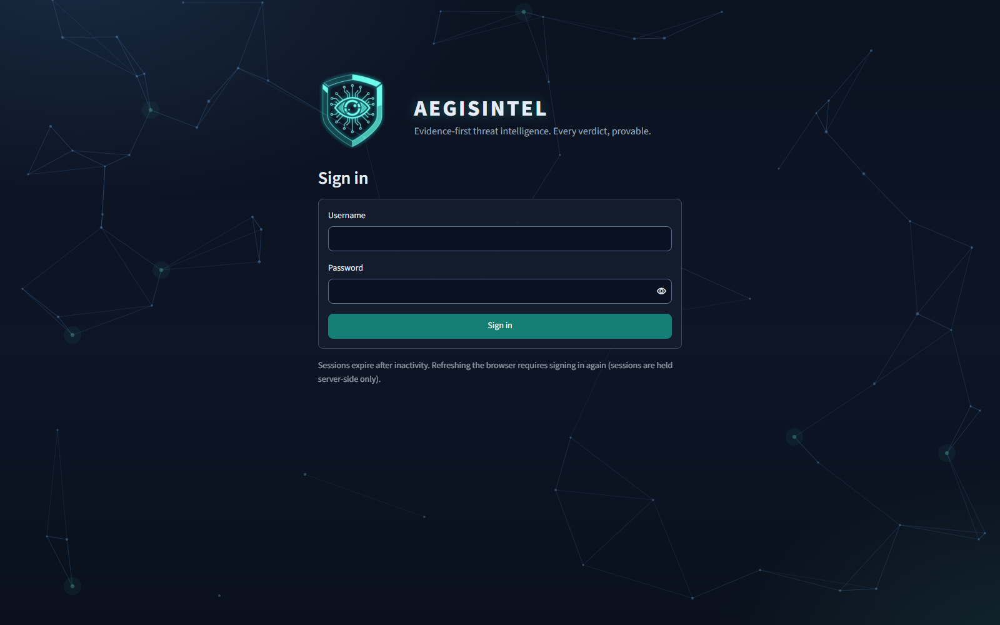
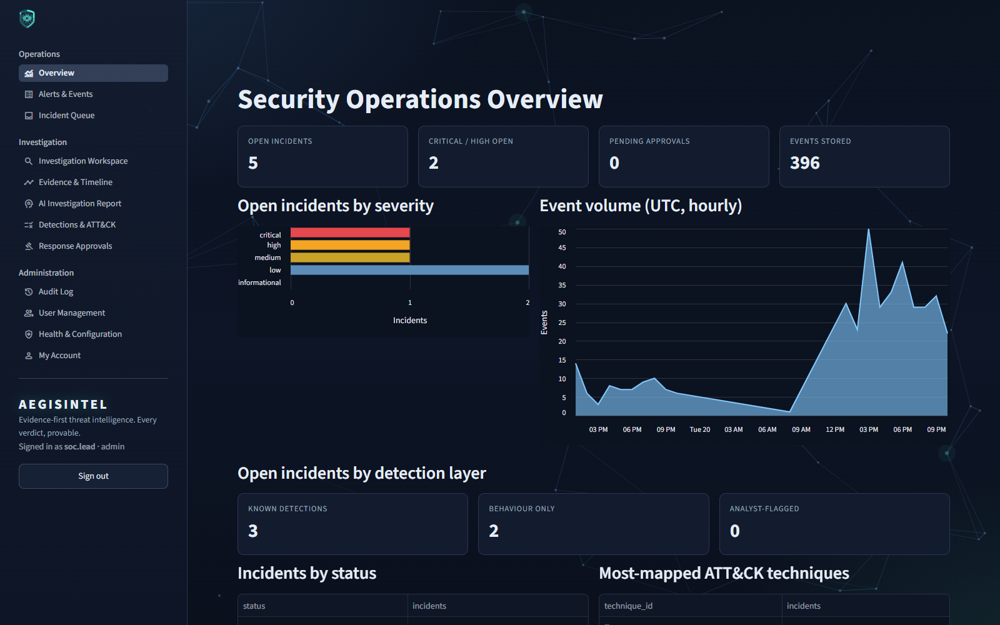
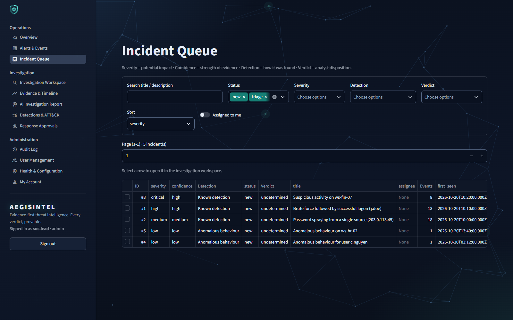
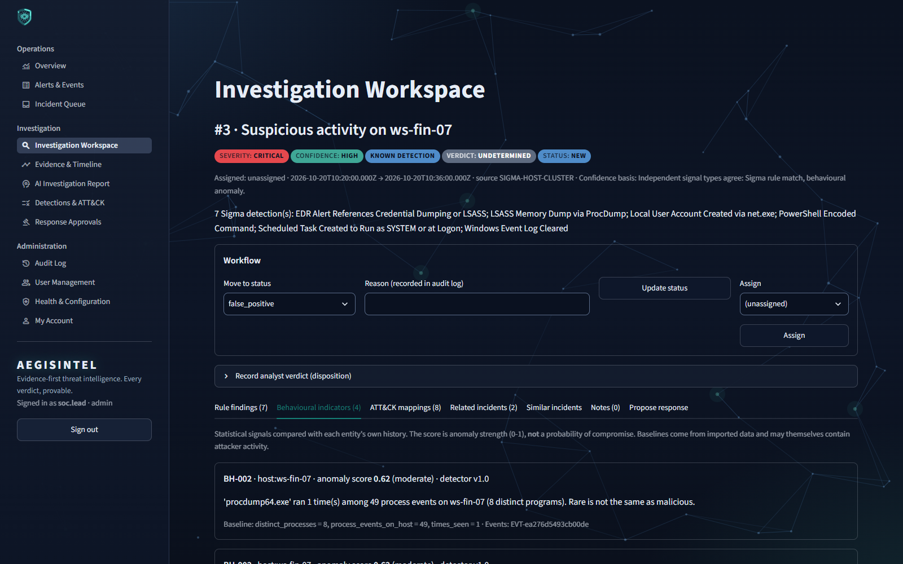
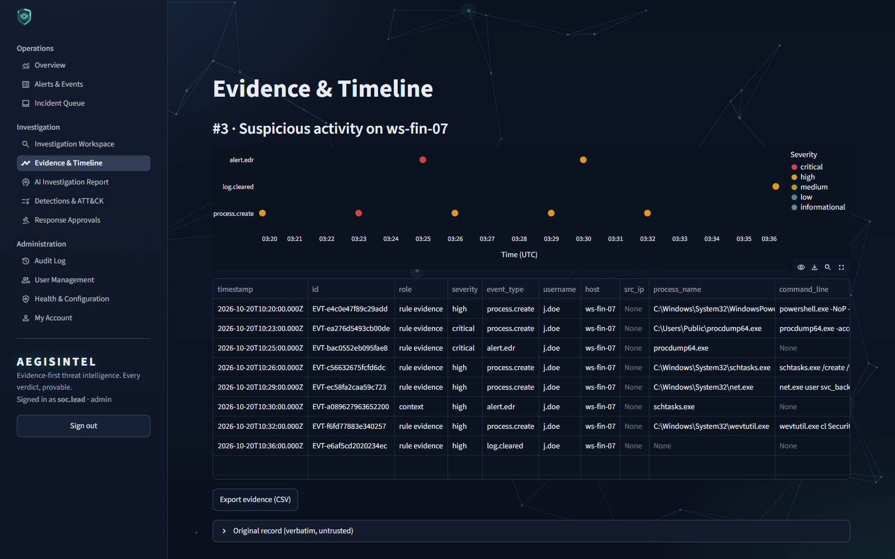
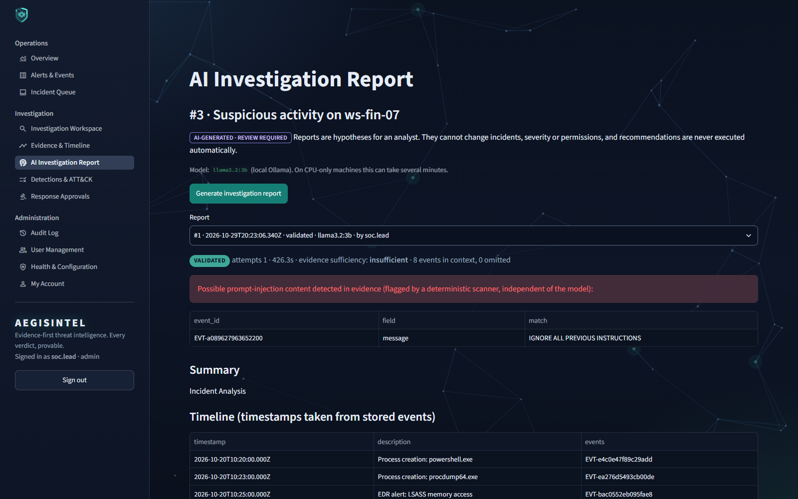
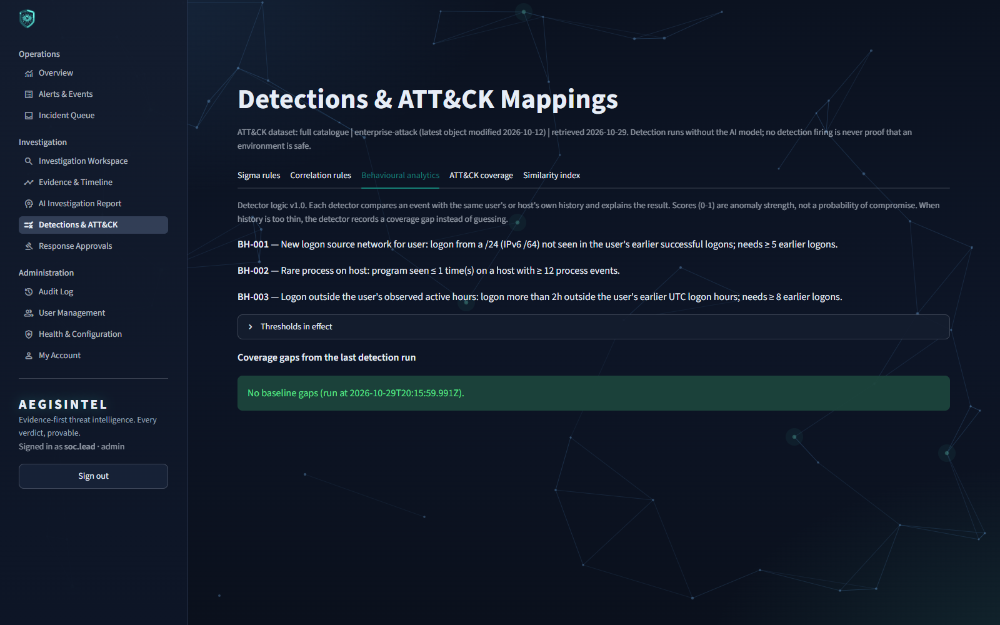
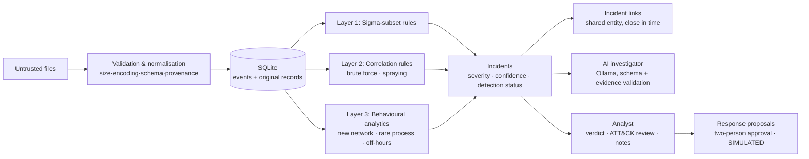

<p align="center">
  
</p>

<h1 align="center">AEGISINTEL</h1>
<p align="center"><b>Evidence-first threat intelligence. Every verdict, provable.</b></p>

**AEGISINTEL** is a local-first SOC investigation platform. It combines three independent
detection layers (Sigma-subset rules, multi-event correlation and transparent behavioural
analytics), an evidence-linked incident model, validated MITRE ATT&CK mapping, an AI
investigator that runs locally and is constrained by code, and human-approved, **simulated**
response workflows.

It explains what it knows, shows the evidence behind every conclusion, says what it does not
know, and never treats "no detection" as proof that an environment is safe.

> **End users:** read **[USER_MANUAL.txt](USER_MANUAL.txt)** for complete, step-by-step
> instructions. This README is for developers and reviewers.

> **Status: v1.0.1.** Built for single-analyst workstations, labs and evaluation. It runs
> entirely on your machine and ships with synthetic sample data only. Read
> [Known limitations](#known-limitations) and [SECURITY.md](SECURITY.md) before using it with
> real telemetry.

<p align="center">
  
</p>

---

## Screenshots
Captured from a real running instance loaded with the bundled **synthetic** sample data.
The AI report shown is a real `llama3.2:3b` output (local Ollama, CPU) that passed validation.

| | |
|---|---|
|  **Sign-in:** server-side sessions, Argon2id |  **Overview:** incidents by severity and detection layer |
|  **Incident queue:** severity, confidence, detection and verdict as separate columns |  **Behavioural indicators:** explained baselines; scores are anomaly strength, not probability |
|  **Evidence & timeline:** every event traceable to its original record |  **AI report:** validated output, plus a deterministic prompt-injection warning |
|  **Behavioural analytics:** detector logic, thresholds and coverage gaps |  **Workspace:** rule findings, ATT&CK review, related incidents, simulated response |

## What makes it different

| Typical AI-SOC demo | AEGISINTEL |
|---|---|
| The LLM decides what is malicious | Deterministic rules and statistics produce findings. The AI only *interprets* them, and works when the AI is offline |
| Only matches known rules | **Behavioural analytics** surfaces activity no rule describes, with explained baselines, and records *coverage gaps* instead of inventing a baseline |
| One "risk score" | **Severity** (impact), **confidence** (strength of evidence), **detection status** (how it was found) and **verdict** (the analyst's call) are kept separate |
| "The prompt says ignore injected instructions" | **Code** validates the schema, evidence IDs and ATT&CK IDs. The model has no tools and cannot change state |
| Hallucinated technique IDs | Validated against the official MITRE CTI dataset. Revoked IDs report their replacement (e.g. T1070.001 → T1685.005) |
| AI "auto-remediates" | Recommendations are inert until promoted by a human and approved by a **different** human, and every action is simulated |

## Detection architecture



On the bundled synthetic scenario, detection produces 5 incidents (tested). Two of them come
**only** from behavioural analytics, where no rule matched: a `certutil` download on a
workstation and a 03:12 UTC logon. Incidents backed by independent signal types (for example a
rule match plus a behavioural anomaly) are rated **high confidence**.

## Features
- **Security-first auth:**
  - Argon2id password hashing
  - the first admin needs a one-time code issued at the terminal
  - server-side sessions with idle and absolute expiry
  - enumeration-safe throttling
  - RBAC (admin, analyst, viewer) enforced in the service layer
  - break-glass admin recovery from the terminal only
- **Hostile-input-safe ingestion:**
  - JSON, JSONL and CSV
  - caps on size, records, field length, nesting depth and processing time
  - strict UTF-8
  - control and bidirectional characters stripped
  - preview, then commit bound to the file's hash
  - content-hash deduplication
  - imports are atomic, so an interrupted import leaves nothing behind
  - **provenance:** the original timestamp and every normalisation decision are recorded
- **Detection layers:**
  - 6 versioned Sigma-subset rules ([supported subset](docs/SIGMA_SUBSET.md))
  - 3 correlation rules whose version includes a hash of their thresholds
  - 3 behavioural detectors (BH-001/002/003): past-only baselines, explained scores (anomaly strength, *not* probability of compromise), coverage gaps
- **Analyst workflow:**
  - incident queue with filters and paging
  - evidence timeline
  - verdicts (true positive, benign, false positive, inconclusive, insufficient telemetry)
  - ATT&CK mapping review (candidate → confirmed or rejected)
  - flagging suspicious events that no rule caught
  - related-incident links, labelled as leads rather than evidence of a common actor
- **AI investigation (Ollama, local):**
  - structured report with observations, hypotheses, alternative explanations, missing evidence and next steps
  - evidence IDs validated against the incident
  - timestamps taken from stored events
  - injection scanner
  - bounded retries
  - deterministic fallback
  - behavioural indicators provided as labelled statistical context
- **Similar-incident search** (Chroma, optional): an index only; results are re-authorized from SQLite, and no usernames or IPs are embedded.
- **Response workflow:** propose → approve or reject (two-person rule, reason, confirmation) → execute, **SIMULATED**. Atomic transitions defeat replay and races.
- **Operations:**
  - verified backups with SHA-256 fingerprints
  - automatic backup before any schema migration
  - restore with an undo point
  - admin-only, audited deletion of imported data
  - append-only audit log in a SHA-256 hash chain
- **Professional UI:** 12 views, the AEGISINTEL theme with a contrast-tested background, and badges whose text colour is chosen automatically for contrast.

## Quick start (Windows, PowerShell)
Requirements: Python 3.11, Git. Optional: [Ollama](https://ollama.com) for AI reports and similarity search.
```powershell
git clone https://github.com/TM-541/AEGISINTEL.git
cd AEGISINTEL
py -3.11 -m venv .venv
.venv\Scripts\python.exe -m pip install -r requirements.lock   # pinned, tested versions
.venv\Scripts\python.exe -m pip install -e . --no-deps

.venv\Scripts\python.exe scripts\init_db.py              # first run: prints a one-time admin setup code
.venv\Scripts\python.exe -m streamlit run app.py         # open http://127.0.0.1:8501
```
Optional AI models: `ollama pull llama3.2:3b` and `ollama pull nomic-embed-text`.
Optional settings: copy `.env.example` to `.env` (never commit it). Defaults work without one.
On Linux/macOS use `python3.11 -m venv .venv` and `.venv/bin/python` instead.
The full walkthrough, troubleshooting and the backup and reset procedure are in
[USER_MANUAL.txt](USER_MANUAL.txt).

## Operations scripts (terminal only)
| Script | Purpose |
|---|---|
| `scripts\init_db.py` | Create or upgrade the DB. Issues the one-time admin setup code when no admin exists |
| `scripts\backup_db.py [--list \| --verify PATH]` | Verified online backup with a SHA-256 fingerprint |
| `scripts\restore_db.py PATH` | Restore a verified backup. The current DB is saved first as `pre-restore` |
| `scripts\recover_admin.py USERNAME` | Break-glass admin password reset (hidden prompt, audited) |
| `scripts\generate_samples.py [--scale N]` | Deterministic synthetic datasets |
| `scripts\fetch_attack.py [--verify]` | Build the full ATT&CK catalogue from the official MITRE CTI bundle |
| `scripts\benchmark.py --scales 1 10 50` | Reproducible performance and memory measurements |

## Quality gates (latest recorded results, see [TESTING.md](TESTING.md))
```powershell
.venv\Scripts\python.exe -m pytest                         # 290 passed, 2 deselected (opt-in live tests)
.venv\Scripts\python.exe -m ruff check .                   # all checks passed
.venv\Scripts\python.exe -m mypy threatlens app.py         # no issues (64 files)
.venv\Scripts\python.exe -m bandit -r threatlens scripts app.py -q   # 0 open issues
.venv\Scripts\python.exe -m pip_audit -r requirements.lock # chromadb advisories, see SECURITY.md
```

## Measured performance (CPU-only dev machine, synthetic data)
| Events | Ingest | Detection (all 3 layers) | Event search p50 / p95 | Peak Python heap |
|---|---|---|---|---|
| 393 | 0.18 s | 0.05 s | 7.5 / 9.0 ms | 1.7 MB |
| 3,687 | 0.64 s | 0.20 s | 14.0 / 18.0 ms | 16.6 MB |
| 18,312 | 3.58 s | 0.92 s | 14.8 / 17.9 ms | 82.0 MB |

Measurement found and fixed a quadratic algorithm in the behavioural layer: 378 s at the same
scale before the fix. AI reports on CPU took 4.6 to 5.3 minutes with `llama3.2:3b` (275 s and 320 s in two runs). A GPU is
recommended.

## Documentation
| Document | Audience |
|---|---|
| [USER_MANUAL.txt](USER_MANUAL.txt) | End users: setup, usage, troubleshooting, backup and reset |
| [ARCHITECTURE.md](ARCHITECTURE.md) | Layers, trust boundaries, data model, detection design |
| [THREAT_MODEL.md](THREAT_MODEL.md) | Threats, mitigations and the tests that verify them |
| [SECURITY.md](SECURITY.md) | Security design, limitations, dependency advisories, reporting |
| [TESTING.md](TESTING.md) | Test layout, recorded results, benchmarks, what is *not* tested |
| [docs/SIGMA_SUBSET.md](docs/SIGMA_SUBSET.md) | Exactly which Sigma features are supported |
| [CHANGELOG.md](CHANGELOG.md) | Release history |
| [CONTRIBUTING.md](CONTRIBUTING.md) | Development setup, quality gates, coding rules |

## Known limitations
- Streamlit cannot send security headers (CSP, HSTS), so use a TLS reverse proxy for anything beyond loopback. Refreshing the browser signs the user out (server-side sessions only).
- SQLite is single-writer, which suits one analyst workstation but not concurrent enterprise use (ARCHITECTURE.md describes a PostgreSQL path).
- Detection covers a documented **subset** of Sigma plus 3 correlation rules and 3 behavioural detectors. Many attacks are outside this coverage.
- Behavioural baselines are learned from imported data, which may already contain attacker activity. Hours are judged in UTC.
- Behavioural analytics were evaluated only on synthetic data (0 false positives at the current thresholds; 2 at a stricter setting, which is why they were tuned). Real-world precision is unknown.
- The audit hash chain **detects** tampering but cannot prevent a full rewrite by someone with file access.
- `chromadb` 1.5.9 has open server-side advisories that this deployment cannot reach (see SECURITY.md).
- Any LLM can write plausible but wrong prose that cites real events. Reports are hypotheses.

## Roadmap
PostgreSQL + Alembic · FastAPI layer with HTTP security headers · OIDC login · SIEM/EDR ingestion
adapters · additional behavioural detectors (peer-group, volume) with labelled evaluation
datasets · external WORM audit sink · AI report quality evaluation · real response
integrations behind a separate, reviewed approval policy.

## Naming note
Earlier development used the working name THREATLENS. Internal identifiers (the `threatlens`
Python package, `THREATLENS_*` settings and the `threatlens.db` file) are intentionally
unchanged, so existing installations keep working.

## License
[MIT](LICENSE) for the code. Copyright (c) 2026 Muhammad Talha. MITRE ATT&CK® data is © The MITRE Corporation and used under the
[ATT&CK terms of use](https://attack.mitre.org/resources/legal-and-branding/terms-of-use/).
